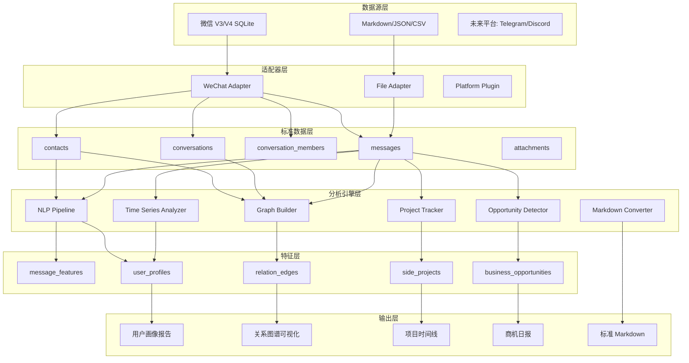

# WeChatMsgArchive 技术方案总结

> 本文档整合了 Codex（代码架构师）和 Kimi（数据处理专家）的技术方案

## 📋 项目概览

从微信聊天记录中挖掘数据价值，实现 7 大核心功能：

1. **用户画像挖掘** - 行为分析、兴趣标签、社交特征
2. **关系图谱构建** - 社交网络、社区发现、互动分析
3. **副业项目追踪** - 项目识别、状态追踪、时间线
4. **商机识别** - 需求发现、价值评估、机会排序
5. **Markdown 转换** - 标准化输出、AI 友好格式
6. **性能优化** - 索引、缓存、增量更新
7. **多平台扩展** - 插件化架构、统一数据模型

---

## 🏗️ 整体架构（Codex 设计）



---

## 🔧 技术栈选型（Codex 推荐）

| 任务 | 核心算法 | Python 库 | 输出表 |
|------|---------|-----------|--------|
| 用户画像 | TF-IDF、TextRank、时间序列 | jieba、sklearn、pandas | user_profiles |
| 关系图谱 | PageRank、Louvain、共现网络 | networkx、igraph | relation_edges |
| 项目追踪 | NER、规则召回、状态机 | HanLP、transitions | side_projects |
| 商机识别 | 情感分析、主题建模 | transformers、SnowNLP | business_opportunities |
| Markdown | 模板渲染、Front Matter | Jinja2、frontmatter | .md 文件 |
| 性能优化 | 索引、FTS、缓存 | SQLite FTS5、diskcache | - |
| 多平台 | 插件化、统一 schema | pydantic、entry_points | - |

---

## 📦 数据处理流水线（Kimi 实现）

### 已交付文件

```
data_analysis/
├── README.md                    # 方案总览
├── scripts/
│   ├── data_extractor.py        # 数据提取（v3/v4 双版本）
│   ├── data_cleaner.py          # 数据清洗与质量报告
│   ├── profile_builder.py       # 分析数据集构建
│   ├── markdown_exporter.py     # Markdown 报告生成
│   └── pipeline_runner.py       # 一键流水线
├── templates/
│   ├── user_profile.md          # 用户画像模板
│   ├── relation_graph.md        # 关系图谱模板
│   └── project_archive.md       # 项目档案模板
├── docs/
│   ├── 数据字典.md               # 字段映射、枚举定义
│   ├── 数据处理流程.md           # 架构图、Schema
│   └── 数据更新维护策略.md        # 增量更新、备份恢复
└── examples/
    └── example_output.md        # 完整输出样例
```

### 核心能力

1. **双版本抽象**
   - `BaseDataExtractor` → `V3DataExtractor` / `V4DataExtractor`
   - 统一输出 `UnifiedMessage` / `UnifiedContact` / `ChatRoomInfo`

2. **增量更新**
   - 基于 `watermark.json` 时间戳水印
   - 只处理新增数据，支持小时级增量

3. **数据清洗**
   - 去重（server_id 主键）
   - 时间戳校验（2010-01-01 ~ 当前+30天）
   - 内容清洗（去除控制字符、提取 URL）
   - 派生字段（date、hour、weekday、is_work_hours）

4. **分析器**
   - `UserProfileAnalyzer`: 24小时分布、类型偏好、社交标签
   - `RelationGraphAnalyzer`: 群聊共现、5分钟窗口回复、私聊关系
   - `ProjectTrackerAnalyzer`: 关键词话题、突发密度、状态推断

5. **Markdown 模板**
   - 支持 `{{variable}}`、`{{#each}}`、`{{#if}}` 语法
   - 自动生成索引页和 Mermaid 图表

---

## 🚀 快速开始

### 一键全量分析

```bash
python data_analysis/scripts/pipeline_runner.py \
    --version v3 \
    --db-dir output/decrypted_db \
    --output-dir data_analysis/output
```

### 增量更新

```bash
python data_analysis/scripts/pipeline_runner.py \
    --version v3 \
    --db-dir output/decrypted_db \
    --mode incremental
```

---

## 📊 已完成：用户画像分析

### 实现文件
- `user_profiling.py` - 用户画像生成脚本

### 分析结果（长腿叔叔）

**基本统计**
- 总消息数：11,380 条
- 联系人数：204 人（88 群聊 + 116 私聊）
- 最活跃时段：21:00-21:59（7,215 条）

**兴趣标签**
- ok (24.9%)、波比 (18.9%)、捂脸 (11.7%)
- 兄弟、机智、老妈、妹子、林哥、超敏

**社交特征**
- 最常联系群组：49487213350@chatroom（810 条）
- 最常联系用户：wxid_sz5fumznp7yk22（1,581 条）

**情感倾向**
- 正面 8.4%，负面 2.5%，整体偏积极

**输出文件**
- `output/user_profiles/wxid_ucag2pjrmhm822_profile.md`
- `output/user_profiles/wxid_ucag2pjrmhm822_profile.json`

---

## 🎯 开发路线（Codex 建议）

### 阶段一：标准数据层 ✅
- [x] 统一数据模型（Kimi 已实现）
- [x] 微信适配器（v3/v4 双版本）
- [x] 增量导入机制
- [x] 索引和 FTS

### 阶段二：NLP 基础分析 🔄
- [x] 用户画像（已完成）
- [ ] 群聊关键词分析
- [ ] 活跃时间热力图
- [ ] 情感分析增强

### 阶段三：图谱分析 📋
- [ ] 构建群聊互动边
- [ ] 计算中心性指标
- [ ] Louvain 社区发现
- [ ] ECharts / PyVis 可视化

### 阶段四：项目与商机 📋
- [ ] 需求关键词词典
- [ ] NER 和规则召回
- [ ] 项目状态机
- [ ] 商机评分模型

### 阶段五：插件化 📋
- [ ] 抽象 DataSourcePlugin
- [ ] 微信适配器迁移
- [ ] Markdown/JSON 导入插件
- [ ] 预留 Telegram/Discord

---

## 💡 关键落地建议（Codex）

1. **优先建设标准数据层**
   - 不要继续写零散脚本
   - 所有分析写入 `archive.sqlite` / `archive.duckdb`

2. **NLP 技术栈演进**
   - MVP: `jieba + sklearn + SnowNLP + networkx`
   - 升级: `BGE + BERTopic + HanLP`

3. **关系图谱技术选型**
   - 小数据: `networkx`
   - 大数据: `igraph` 或 `Neo4j`

4. **商机识别策略**
   - 规则召回 + 模型排序 + 人工校正
   - 不要一开始追求纯模型

5. **Markdown 定位升级**
   - 从"展示导出"升级为"结构化知识库"

---

## 📝 下一步行动

1. **测试 Kimi 的数据流水线**
   ```bash
   python data_analysis/scripts/pipeline_runner.py --version v3 --db-dir output/decrypted_db
   ```

2. **实现关系图谱分析**
   - 使用 `networkx` 构建社交网络
   - 计算 PageRank 和社区结构

3. **实现项目追踪**
   - 定义副业项目关键词
   - 构建项目状态机
   - 生成项目时间线

4. **实现商机识别**
   - 构建需求关键词词典
   - 实现情感分析
   - 生成商机日报

5. **性能优化**
   - 添加数据库索引
   - 实现缓存机制
   - 优化增量更新

---

## 🔗 相关文档

- [数据分析方案 README](data_analysis/README.md)
- [数据字典](data_analysis/docs/数据字典.md)
- [数据处理流程](data_analysis/docs/数据处理流程.md)
- [维护策略](data_analysis/docs/数据更新维护策略.md)

---

## 👥 贡献者

- **Codex (OpenAI)** - 技术架构设计、算法选型、开发路线
- **Kimi (Moonshot AI)** - 数据处理流水线、脚本实现、文档编写
- **Claude (Anthropic)** - 项目协调、用户画像实现、方案整合
