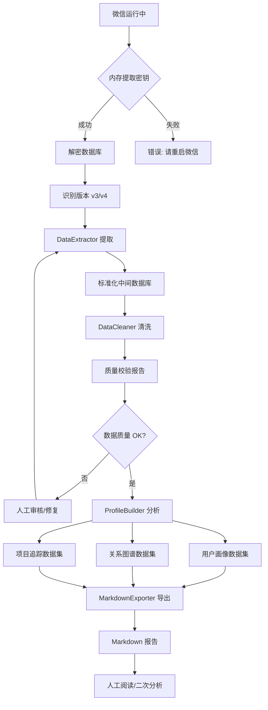

# WeChatMsgArchive 数据处理流程与架构

## 1. 总体架构

```
┌─────────────────────────────────────────────────────────────────────────────┐
│                           数据源层 (Source Layer)                            │
│  ┌─────────────┐  ┌─────────────┐  ┌─────────────┐  ┌─────────────────────┐ │
│  │  MSG*.db    │  │ MicroMsg.db │  │ MediaMSG.db │  │ HardLink*.db        │ │
│  │  (消息内容)  │  │ (联系人)    │  │ (语音数据)  │  │ (文件路径映射)       │ │
│  └─────────────┘  └─────────────┘  └─────────────┘  └─────────────────────┘ │
│         v3 / v4 双版本兼容                                                    │
└─────────────────────────────────────────────────────────────────────────────┘
                                      ↓
┌─────────────────────────────────────────────────────────────────────────────┐
│                         解密层 (Decrypt Layer)                               │
│  ┌────────────────────────────────────────────────────────────────────────┐ │
│  │  wxManager.decrypt.decrypt_v3 / decrypt_v4                            │ │
│  │  - 从 WeChat.exe 内存提取密钥                                          │ │
│  │  - AES-CBC 解密 SQLite 数据库                                          │ │
│  │  - 输出到 output/decrypted_db/                                         │ │
│  └────────────────────────────────────────────────────────────────────────┘ │
└─────────────────────────────────────────────────────────────────────────────┘
                                      ↓
┌─────────────────────────────────────────────────────────────────────────────┐
│                        提取层 (Extraction Layer)                             │
│  ┌────────────────────────────────────────────────────────────────────────┐ │
│  │  data_extractor.py                                                     │ │
│  │  ├─ V3DataExtractor: 适配微信 v3 数据库结构                             │ │
│  │  ├─ V4DataExtractor: 适配微信 v4 数据库结构                             │ │
│  │  └─ 输出: unified_data_v3.db / unified_data_v4.db                      │ │
│  │     - messages 表: 标准化消息记录                                       │ │
│  │     - contacts 表: 标准化联系人信息                                     │ │
│  │     - chatrooms 表: 标准化群聊信息                                      │ │
│  │     - chatroom_members 表: 群成员关系                                   │ │
│  └────────────────────────────────────────────────────────────────────────┘ │
└─────────────────────────────────────────────────────────────────────────────┘
                                      ↓
┌─────────────────────────────────────────────────────────────────────────────┐
│                        清洗层 (Cleaning Layer)                               │
│  ┌────────────────────────────────────────────────────────────────────────┐ │
│  │  data_cleaner.py                                                       │ │
│  │  ├─ 去重: 基于 server_id 去重                                           │ │
│  │  ├─ 时间戳校验: 过滤异常时间                                             │ │
│  │  ├─ 内容清洗: 去除控制字符、填充默认值                                   │ │
│  │  ├─ 发送者修复: 未知发送者标记                                           │ │
│  │  ├─ 派生字段: date, hour, weekday, is_work_hours, content_length       │ │
│  │  └─ 输出: cleaned_data.db + clean_report.json                          │ │
│  │     - messages_clean 表: 清洗后的消息                                   │ │
│  │     - user_stats 表: 用户基础统计                                       │ │
│  │     - talker_stats 表: 聊天对象统计                                     │ │
│  │     - daily_stats 表: 日期聚合统计                                      │ │
│  └────────────────────────────────────────────────────────────────────────┘ │
└─────────────────────────────────────────────────────────────────────────────┘
                                      ↓
┌─────────────────────────────────────────────────────────────────────────────┐
│                       分析层 (Analysis Layer)                                │
│  ┌─────────────────────┐  ┌─────────────────────┐  ┌─────────────────────┐ │
│  │ UserProfileAnalyzer │  │RelationGraphAnalyzer│  │ProjectTrackerAnalyzer│ │
│  │    (用户画像分析)    │  │    (关系图谱分析)    │  │    (项目追踪分析)    │ │
│  │                     │  │                     │  │                     │ │
│  │ • 时间模式分析       │  │ • 群聊共现关系       │  │ • 关键词话题发现     │ │
│  │ • 内容偏好分析       │  │ • 回复互动关系       │  │ • 突发密度检测       │ │
│  │ • 社交特征提取       │  │ • 私聊直接关系       │  │ • 状态推断           │ │
│  │ • 自动标签生成       │  │ • 关系权重计算       │  │ • 参与者分析         │ │
│  └─────────────────────┘  └─────────────────────┘  └─────────────────────┘ │
│                                      ↓                                      │
│  输出: user_profiles.json / relation_graph.json / project_topics.json      │
└─────────────────────────────────────────────────────────────────────────────┘
                                      ↓
┌─────────────────────────────────────────────────────────────────────────────┐
│                       输出层 (Output Layer)                                  │
│  ┌────────────────────────────────────────────────────────────────────────┐ │
│  │  markdown_exporter.py                                                  │ │
│  │  ├─ user_profile.md    — 个人画像报告                                  │ │
│  │  ├─ relation_graph.md  — 关系图谱报告                                  │ │
│  │  ├─ project_archive.md — 项目追踪档案                                  │ │
│  │  └─ profile_index.md   — 用户画像索引                                  │ │
│  └────────────────────────────────────────────────────────────────────────┘ │
└─────────────────────────────────────────────────────────────────────────────┘
```

---

## 2. 流水线执行顺序



---

## 3. 模块职责说明

### 3.1 data_extractor.py

**输入**: `output/decrypted_db/` 下的解密数据库文件  
**输出**: `data_analysis/output/unified_data_{v3|v4}.db`

**核心方法**:
- `extract_contacts()`: 从 MicroMsg.db / contact.db 提取联系人/群聊
- `extract_chatrooms()`: 提取群聊信息和成员列表
- `extract_messages(talker_ids)`: 提取指定聊天对象的消息
- `parse_message_row()`: 版本差异抽象，统一输出格式

**设计要点**:
- 使用抽象基类 `BaseDataExtractor`，v3/v4 分别实现
- `UnifiedMessage` / `UnifiedContact` / `ChatRoomInfo` 为标准数据模型
- 支持增量提取（通过 `incremental_after` 时间戳参数）

### 3.2 data_cleaner.py

**输入**: `unified_data_*.db`  
**输出**: `cleaned_data.db` + `clean_report.json`

**核心流程**:
1. 去重（基于 server_id）
2. 时间戳校验（范围: 2010-01-01 至 当前+30天）
3. 内容清洗（去除控制字符、XML 标签清理、URL 提取）
4. 发送者修复（未知发送者分配占位 ID）
5. 统计计算（user_stats, talker_stats, daily_stats）

**清洗报告指标**:
- 清洗前后消息数
- 去重数量、无效时间数量、空内容数量
- 类型分布变化
- 日期范围、Top 聊天对象

### 3.3 profile_builder.py

**输入**: `cleaned_data.db`  
**输出**: `user_profiles.json` + `relation_graph.json` + `project_topics.json`

**三大分析器**:

| 分析器 | 核心算法 | 输出 |
|--------|---------|------|
| UserProfileAnalyzer | 时间聚合、类型占比、互动对统计 | 用户画像JSON |
| RelationGraphAnalyzer | 群聊共现、时间窗口回复检测、私聊统计 | 关系边列表 |
| ProjectTrackerAnalyzer | 关键词匹配、突发密度检测、状态推断 | 话题列表 |

### 3.4 markdown_exporter.py

**输入**: 分析数据集 JSON + Markdown 模板  
**输出**: `.md` 报告文件

**模板系统**:
- 支持 `{{variable}}` 变量替换
- 支持 `{{#each list}}...{{/each}}` 循环
- 支持 `{{#if cond}}...{{else}}...{{/if}}` 条件

---

## 4. 数据流与存储格式

### 4.1 中间数据库 Schema

```sql
-- 标准化消息表 (messages / messages_clean)
CREATE TABLE messages_clean (
    server_id INTEGER PRIMARY KEY,
    local_id INTEGER,
    timestamp INTEGER,
    str_time TEXT,
    date TEXT,
    hour INTEGER,
    weekday INTEGER,
    is_work_hours INTEGER,
    is_weekend INTEGER,
    msg_type INTEGER,
    msg_type_name TEXT,
    talker_id TEXT,
    talker_name TEXT,
    is_sender INTEGER,
    sender_id TEXT,
    sender_name TEXT,
    content TEXT,
    content_clean TEXT,        -- 清洗后文本（去URL、去XML）
    content_length INTEGER,
    has_url INTEGER,
    url_list TEXT,
    is_reply INTEGER,
    reply_to_id INTEGER,
    status INTEGER,
    source_version TEXT
);

-- 用户统计表
CREATE TABLE user_stats (
    wxid TEXT PRIMARY KEY,
    display_name TEXT,
    total_messages INTEGER,
    total_chars INTEGER,
    text_messages INTEGER,
    image_messages INTEGER,
    voice_messages INTEGER,
    video_messages INTEGER,
    link_messages INTEGER,
    file_messages INTEGER,
    first_seen TEXT,
    last_seen TEXT,
    active_days INTEGER,
    peak_hour INTEGER,
    avg_message_length REAL,
    is_my_contact INTEGER
);

-- 聊天对象统计表
CREATE TABLE talker_stats (
    talker_id TEXT PRIMARY KEY,
    talker_name TEXT,
    is_chatroom INTEGER,
    total_messages INTEGER,
    my_messages INTEGER,
    other_messages INTEGER,
    member_count INTEGER,
    first_message TEXT,
    last_message TEXT,
    active_days INTEGER,
    message_types TEXT
);

-- 日期统计表
CREATE TABLE daily_stats (
    date TEXT PRIMARY KEY,
    total_messages INTEGER,
    unique_talkers INTEGER,
    unique_senders INTEGER,
    work_hours_messages INTEGER,
    weekend_messages INTEGER
);
```

### 4.2 分析数据集 JSON 结构

**user_profiles.json**:
```json
{
  "wxid_xxx": {
    "wxid": "wxid_xxx",
    "display_name": "张三",
    "total_messages": 1523,
    "active_days": 45,
    "hourly_distribution": {"9": 120, "10": 200, ...},
    "weekday_distribution": {"0": 300, "1": 250, ...},
    "work_life_ratio": 0.72,
    "type_distribution": {"文本": 1000, "图片": 300, ...},
    "tags": ["高活跃", "工作狂", "话痨型"],
    "persona_summary": "张三是一个..."
  }
}
```

**relation_graph.json**:
```json
{
  "wxid_xxx": [
    {
      "source": "wxid_xxx",
      "target": "wxid_yyy",
      "relation_type": "co_group",
      "weight": 5.0,
      "common_groups": ["群ID1", "群ID2"]
    }
  ]
}
```

**project_topics.json**:
```json
[
  {
    "topic_id": "kw_1234",
    "topic_name": "开发",
    "keywords": ["开发", "代码", "bug"],
    "start_time": "2024-01-01",
    "end_time": "2024-03-01",
    "participants": ["wxid_xxx", "wxid_yyy"],
    "status": "ongoing",
    "message_count": 523
  }
]
```

---

## 5. 性能与扩展性

### 5.1 大数据量处理

| 数据规模 | 处理策略 |
|---------|---------|
| < 10万条消息 | 单线程处理，内存加载 |
| 10万 - 100万条 | 批量插入（batch_size=5000），SQLite WAL 模式 |
| > 100万条 | 可考虑分表（按月分 messages 表），或使用 DuckDB |

### 5.2 扩展点

1. **新增消息类型**: 在 `MessageType` 映射表和 `data_extractor` 解析逻辑中添加
2. **新增分析维度**: 继承 `BaseAnalyzer`，实现新的分析器类
3. **新增输出格式**: 扩展 `markdown_exporter.py` 或新增 exporter
4. **接入 LLM**: 在 `profile_builder.py` 中接入大模型进行深度语义分析

---

## 6. 错误处理与恢复

| 阶段 | 可能错误 | 处理策略 |
|------|---------|---------|
| 数据库解密 | 密钥获取失败 | 提示重启微信，记录错误码 |
| 消息提取 | 表不存在 (v4 分表) | 跳过该 talker，记录日志 |
| 内容解析 | XML 解析失败 | 保留原始字符串，标记错误 |
| 压缩解压 | lz4/zstd 解压失败 | 跳过结构化提取，标记错误 |
| 清洗阶段 | 时间戳全为0 | 使用 sort_seq 推算，标记 Invalid |
| 分析阶段 | 数据为空 | 输出空结果文件，不中断流水线 |
