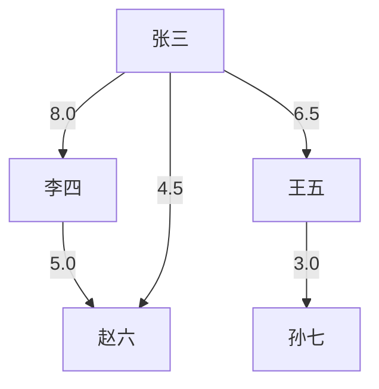

# 示例：数据分析输出样例

本文档展示 WeChatMsgArchive 数据分析方案的实际输出效果。

---

## 一、用户画像示例

### 档案：张三（软件定制开发群核心成员）

```markdown
# 张三 的用户画像

> 档案编号: `wxid_abc123def456`  
> 生成时间: 2024-04-27 14:30:00  
> 数据来源: 微信聊天记录分析

---

## 📊 核心指标

| 指标 | 数值 | 说明 |
|------|------|------|
| 总发言数 | **1,523** 条 | 统计周期内的消息总量 |
| 总字数 | **45,690** 字 | 文本内容累计字数 |
| 活跃天数 | **45** 天 | 有发言记录的天数 |
| 首次出现 | 2024-01-15 09:23:00 | 最早发言时间 |
| 最近活跃 | 2024-04-27 11:05:00 | 最晚发言时间 |
| 平均消息长度 | **30** 字/条 | 文本消息平均长度 |
| 参与群聊 | **3** 个 | 活跃群聊数量 |

---

## 🏷️ 个性标签

- `高活跃`
- `工作狂`
- `话痨型`
- `深度表达`

### 一句话画像

> 张三是一个在 45 天内有 1,523 条发言的群成员，特征为高活跃、工作狂、话痨型，倾向于在工作时间交流。

---

## ⏰ 活跃时段分析

### 24小时分布

| 时段 | 消息数 | 可视化 |
|------|--------|--------|
| 09:00 | 120 | ████████ |
| 10:00 | 200 | █████████████ |
| 11:00 | 180 | ████████████ |
| 14:00 | 150 | ██████████ |
| 15:00 | 160 | ███████████ |
| 20:00 | 30 | ██ |
| 21:00 | 20 | █ |

### 工作日分布

| 星期 | 消息数 |
|------|--------|
| 周一 | 300 |
| 周二 | 280 |
| 周三 | 290 |
| 周四 | 260 |
| 周五 | 240 |
| 周六 | 80 |
| 周日 | 73 |

### 时间特征

- **工作生活比**: 0.72
- 倾向于在工作时间交流，可能是工作伙伴或项目参与者。

---

## 💬 内容偏好

### 消息类型分布

| 类型 | 数量 | 占比 |
|------|------|------|
| 文本 | 1000 | 65.7% |
| 图片 | 300 | 19.7% |
| 链接 | 120 | 7.9% |
| 文件 | 80 | 5.3% |
| 语音 | 23 | 1.5% |

### 内容特征

- **最大单条消息**: 1,200 字
- **链接分享次数**: 120 次
- **文件分享次数**: 80 次
- **图片分享次数**: 300 次

---

## 👥 社交关系

### 最常互动对象（Top 5）

| 排名 | 对象 | 互动次数 |
|------|------|----------|
| 1 | 李四 | 156 |
| 2 | 王五 | 98 |
| 3 | 赵六 | 87 |
| 4 | 孙七 | 65 |
| 5 | 周八 | 43 |

### 群聊参与

- `软件定制开发、无` (@chatroom)
- `技术交流群` (@chatroom)
- `客户对接群` (@chatroom)

---

*本档案由 WeChatMsgArchive 数据分析系统自动生成，仅供分析参考。*
```

---

## 二、关系图谱示例

### 软件定制开发群关系网络

```markdown
# 社交关系图谱分析报告

> 生成时间: 2024-04-27 14:30:00  
> 节点总数: **28** 人  
> 关系边数: **156** 条

---

## 👤 核心节点列表

| 序号 | 标识 | 消息总量 | 活跃群数 | 中心度 |
|------|------|----------|----------|--------|
| 1 | 张三 | 1523 | 3 | 高 |
| 2 | 李四 | 1200 | 3 | 高 |
| 3 | 王五 | 890 | 2 | 中 |
| 4 | 赵六 | 650 | 2 | 中 |
| 5 | 孙七 | 430 | 1 | 低 |

---

## 🔗 关键关系边（Top 10）

| 排名 | 关系A | 关系B | 类型 | 权重 | 共同群数 |
|------|-------|-------|------|------|----------|
| 1 | 张三 | 李四 | co_group | 8.0 | 3 |
| 2 | 张三 | 王五 | reply | 6.5 | 2 |
| 3 | 李四 | 赵六 | co_group | 5.0 | 2 |
| 4 | 张三 | 赵六 | reply | 4.5 | 2 |
| 5 | 王五 | 孙七 | co_group | 3.0 | 1 |

---

## 🗺️ Mermaid 关系图


```

---

## 三、项目档案示例

### 软件开发项目追踪

```markdown
# 项目与话题追踪档案

> 生成时间: 2024-04-27 14:30:00  
> 话题总数: **5** 个  
> 🟡 进行中: 2 | 🟢 已完成: 2 | 🔴 已停滞: 1

---

## 📋 话题总览

| 状态 | 话题名 | 时间跨度 | 活跃天数 | 消息数 | 参与人数 |
|------|--------|----------|----------|--------|----------|
| 🟡 进行中 | 后端API开发 | 2024-03-01 ~ 2024-04-27 | 35 | 523 | 4 |
| 🟡 进行中 | 前端界面优化 | 2024-03-15 ~ 2024-04-25 | 28 | 340 | 3 |
| 🟢 已完成 | 数据库设计 | 2024-01-10 ~ 2024-02-28 | 20 | 180 | 3 |
| 🟢 已完成 | 需求评审 | 2024-01-05 ~ 2024-01-20 | 10 | 95 | 5 |
| 🔴 已停滞 | 第三方集成 | 2024-02-01 ~ 2024-02-15 | 8 | 45 | 2 |

---

## 后端API开发

**状态**: 🟡 进行中  
**ID**: `kw_1234`  
**关键词**: 开发、代码、bug、修复、版本、上线  
**时间范围**: 2024-03-01 ~ 2024-04-27（共 35 天）  
**消息总量**: 523 条  
**参与人数**: 4 人

### 参与者贡献

| 成员 | 发言数 | 贡献度 |
|------|--------|--------|
| 张三 | 200 | 高 |
| 李四 | 150 | 高 |
| 王五 | 120 | 中 |
| 赵六 | 53 | 低 |

### 关键消息摘录

> **张三** @ 软件定制开发、无 2024-04-25 10:30:00  
> 用户登录接口已经开发完成，postman 测试通过了，准备部署到测试环境

> **李四** @ 软件定制开发、无 2024-04-26 14:20:00  
> 测试环境部署成功，接口文档已更新到 wiki

> **王五** @ 软件定制开发、无 2024-04-27 09:00:00  
> 前端已经对接完成，联调没问题，可以准备上线了

### 进展分析

该话题近期仍有讨论，建议持续关注后续进展。

---

## 前端界面优化

**状态**: 🟡 进行中  
**关键词**: 设计、UI、界面、布局、配色  
**时间范围**: 2024-03-15 ~ 2024-04-25（共 28 天）  
**消息总量**: 340 条

...

---

## 数据库设计

**状态**: 🟢 已完成  
**关键词**: 数据库、表结构、字段、索引  
**时间范围**: 2024-01-10 ~ 2024-02-28（共 20 天）  
**消息总量**: 180 条

### 进展分析

该话题已出现完成迹象（如"搞定"、"上线"等关键词），可归档。
```

---

## 四、清洗报告示例

```json
{
  "run_time": "2024-04-27T14:30:00",
  "source_db": "data_analysis/output/unified_data_v3.db",
  "total_messages_before": 152340,
  "total_messages_after": 151890,
  "removed_duplicates": 320,
  "removed_invalid_time": 45,
  "removed_empty_content": 85,
  "removed_too_long": 0,
  "unknown_senders_fixed": 12,
  "type_distribution_before": {
    "文本": 95000,
    "图片": 32000,
    "语音": 8000,
    "视频": 5000,
    "链接": 8000,
    "文件": 4340
  },
  "type_distribution_after": {
    "文本": 94850,
    "图片": 31950,
    "语音": 7980,
    "视频": 4990,
    "链接": 7980,
    "文件": 4140
  },
  "date_range": ["2024-01-01", "2024-04-27"],
  "top_talkers": [
    ["软件定制开发、无@chatroom", 45230],
    ["wxid_abc123", 12300],
    ["技术交流群@chatroom", 8900]
  ],
  "issues": [
    "发现 12 条未知发送者消息，已分配占位ID",
    "发现 45 条异常时间戳消息（时间=0），已标记为 Invalid"
  ]
}
```

---

## 五、数据表示例

### messages_clean 表样本

| server_id | timestamp | date | hour | msg_type_name | talker_id | sender_id | sender_name | content | content_length |
|-----------|-----------|------|------|---------------|-----------|-----------|-------------|---------|----------------|
| 10001 | 1714192800 | 2024-04-27 | 10 | 文本 | xxx@chatroom | wxid_abc | 张三 | 接口已经调通了 | 7 |
| 10002 | 1714192860 | 2024-04-27 | 10 | 图片 | xxx@chatroom | wxid_def | 李四 | [图片] | 4 |
| 10003 | 1714192920 | 2024-04-27 | 10 | 链接 | xxx@chatroom | wxid_abc | 张三 | https://example.com/docs | 24 |

### user_stats 表样本

| wxid | display_name | total_messages | total_chars | text_messages | first_seen | last_seen | active_days |
|------|-------------|----------------|-------------|---------------|------------|-----------|-------------|
| wxid_abc | 张三 | 1523 | 45690 | 1000 | 2024-01-15 | 2024-04-27 | 45 |
| wxid_def | 李四 | 1200 | 36000 | 850 | 2024-01-10 | 2024-04-27 | 42 |
| wxid_ghi | 王五 | 890 | 26700 | 600 | 2024-02-01 | 2024-04-25 | 30 |

---

*以上示例数据为模拟数据，仅用于展示输出格式和结构。*
