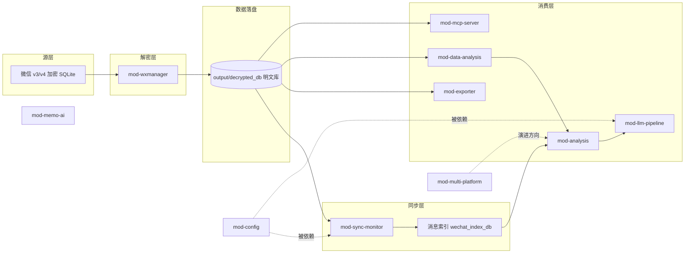

# 整体架构与模块边界

## 拓扑

数据单向流动：**加密数据源 → 解密 → 明文落盘 → 同步/索引 → 消费（导出 / 流水线 / 分析 / 接口）→ 报告与看板**。

## 模块与依赖边

| 模块 | 位置 | 职责 | depends-on |
|---|---|---|---|
| `mod-wxmanager` | `wxManager/` | 微信 v3/v4 数据库解密、读写、解析、数据模型 | —（最底层） |
| `mod-sync-monitor` | `wechat_sync.py`、`incremental_sync.py`、`wechat_index_db.py`、`wechat_realtime_monitor_clean.py` | 一键同步工作流、增量同步、消息索引、文件系统实时监控 | mod-wxmanager, mod-config |
| `mod-exporter` | `exporter/` | 8 种格式消息/联系人导出 | mod-wxmanager |
| `mod-data-analysis` | `data_analysis/` | 双版本抽取、清洗、增量水印、统一模型、Markdown 报告 | mod-sync-monitor（数据源） |
| `mod-analysis` | `user_profiling.py`、`social_graph_analysis.py`、`business_opportunity.py`、`project_tracker.py`、`message_threader.py` | 画像、关系图谱、项目追踪、商机识别、消息串线 | mod-sync-monitor（索引与明文库） |
| `mod-llm-pipeline` | `.claude/`、`llm_requirement_analyzer.py`、`auto_requirement_collector.py`、`kanban_writer.py` | LLM 语义分析、自动流水线、看板同步 | mod-config |
| `mod-config` | `config.py`、`config_loader.py` | Pydantic 配置管理、环境变量、多环境 | — |
| `mod-mcp-server` | `mcp_servers/wechat_data/` | MCP 标准化查询接口（消息/联系人/群聊） | mod-sync-monitor（数据源） |
| `mod-memo-ai` | `MemoAI/` | 本地 Qwen 模型 AI 聊天服务 | — |
| `mod-multi-platform` | `multi_platform_framework.py` | PlatformAdapter 多平台统一数据模型（**长期演进方向**，已实现未接入主流程） | — |

依赖边只画代码中真实存在的；`mod-memo-ai` 与其余模块无代码级依赖，独立运行。

## 不变量

1. **解密唯一入口**：只有 `wxManager.decrypt` 允许接触加密数据库与微信进程内存（pymem / pywin32）；其余任何模块只读 `output/decrypted_db` 下的明文 SQLite。
2. **不回写源库**：任何模块不得写回微信原始数据库；解密产物只写在 `output/` 下。
3. **导出统一走 exporter**：新导出需求扩展 `exporter/`，分析脚本不自行生成 HTML/DOCX。
4. **多平台架构为演进方向，非现状**：新分析功能鼓励经 `PlatformAdapter` 接口编写，但当前未强制——`multi_platform_framework` 仅被验收测试引用（经用户确认此定位）。
5. **一次性脚本在边界之外**（经用户确认）：根目录 `search_*.py`、按群/按人/按日期的临时导出脚本不属于任何模块，不受不变量 1–3 约束，新功能不得模仿其模式。
6. **实时监控以 `wechat_realtime_monitor_clean.py` 为准**（经用户确认）：`_v2`、`_fixed`、无后缀等变体为历史遗留，修改监控逻辑只改 clean 版。
7. **配置不硬编码**：新脚本通过 `mod-config` 读取配置，不新增硬编码路径与密钥。

## 已知边界说明

- `wechat_msg_reader.py`、`wechat_message_fetcher.py`、`message_threader.py` 处于同步与分析之间，当前归入 mod-analysis（以索引/明文库为输入）。
- `.claude/` 下的 xhs（小红书）采集脚本属于临时业务采集，不单独建模块；如长期化再提升。
